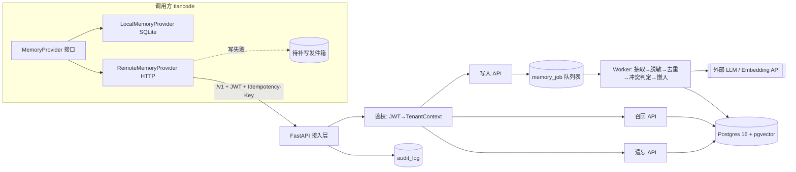

# agent-memory 系统架构（v1）

## 1. 目标与边界
- 给 tiancode（及后续其它 Agent）提供**多租户长期记忆**：长期事实/偏好 + 会话摘要。
- **不管**：任务状态、checkpoint、工作记忆（属于调用方 Runtime）。
- v1 不做：情景记忆、图谱、后台整合、程序性记忆。

## 2. 总体架构

## 3. 组件职责
| 组件 | 职责 | 关键约束 |
|---|---|---|
| 接入层 | 路由、版本 `/v1`、限流、请求 ID / traceparent | 不接受 body 里的 tenant_id/user_id |
| 鉴权 | 校验 JWT（服务间 token + 透传用户 token），生成 `TenantContext` | 租户只来自 token |
| 写入 API | 校验、幂等登记、入队，立即返回 `202 + job_id` | 同一 `Idempotency-Key` 只处理一次 |
| Worker | LLM 抽取候选事实 → 脱敏 → 相似检索去重 → 规则判定 ADD/UPDATE/NOOP → 嵌入 → 入库 | 模型只给建议，判定规则在代码里 |
| 召回 API | 租户/用户硬过滤 → 向量 top-N + BM25 top-N → RRF 融合 → 只取 `valid_to IS NULL` → token 预算裁剪 | 结果带 `fact_id` 便于审计 |
| 遗忘 API | 按 id / 按主题物理删除，含向量 | 删除写审计，不留正文 |
| 审计 | 每次写入/召回/遗忘记录 | 回放靠 `trace_id + model 版本` |

## 4. 数据模型（v1）
- `memory_fact(id, tenant_id, user_id, subject, predicate, value, content, embedding vector, embed_model, tsv tsvector, valid_from, valid_to, source_session_id, source_msg_id, version, created_at)`
  - 索引：`(tenant_id, user_id) WHERE valid_to IS NULL`、HNSW(embedding)、GIN(tsv)
- `session_summary(id, tenant_id, user_id, session_id, summary, upto_msg_id, model, updated_at)`
- `memory_job(id, tenant_id, idempotency_key UNIQUE(tenant_id, key), payload, status, attempts, last_error, created_at)`
- `audit_log(id, trace_id, tenant_id, user_id, action, fact_ids, filtered_count, decision, model, embed_model, prompt_version, latency_ms, created_at)`

## 5. 关键流程
**写入**：`POST /v1/memories {session_id, messages[]}` → 202 → Worker 处理。事实冲突时旧行写 `valid_to=now()`，插入新行 `version+1`（借鉴 Graphiti 时序失效）。
**召回**：`POST /v1/memories/recall {query, k, token_budget}` → `{facts[], summary}`。
**摘要**：`POST /v1/sessions/{id}/summarize`，增量滚动。
**遗忘**：`DELETE /v1/memories/{id}`、`POST /v1/memories/forget {subject}`。

## 6. 非功能
- **隔离**：每条 SQL 带 `tenant_id`；可选 Postgres RLS 兜底。
- **降级**：召回失败→本轮无长期记忆 + `memory_degraded=true` 告警；写失败→调用方发件箱（不参与召回），恢复后按幂等键补写，积压告警。
- **可观测**：JSON 日志、请求 ID、`/healthz` `/readyz`、写入队列积压指标。
- **安全**：脱敏（手机号/身份证等）在入库前；公开仓库只放假数据；gitleaks + GitHub secret scanning。
- **资源**：无 GPU，LLM/embedding 走 API；4C8G 单机即可。

## 7. 部署
- `proxy-4`：api + worker + postgres（Compose）；`proxy-3`：Jenkins。
- Jenkins：gitleaks → lint → pytest（含四类评测/契约测试）→ 构建镜像（Git SHA tag）→ 推镜像 → `alembic upgrade` → `compose up -d` → `/readyz` 冒烟，失败回滚上一 tag。
- 每日 `pg_dump` 到 GCP 练习机，每周恢复演练。磁盘：Jenkins 保留 10 次构建，定时 `docker image prune`。

## 8. 评测门禁
记住了吗 / 记错了吗 / 失效后不召回旧值 / 不串租户；Local 与 Remote 两实现跑同一套契约测试。

## 9. 演进
v2：情景记忆、后台整合、MCP server 接入；量大再把队列换 Redis、事实关系换图存储。
