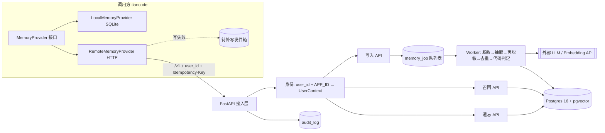
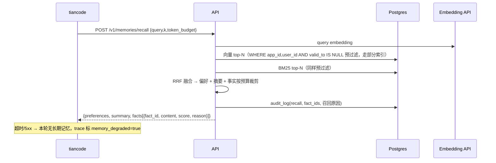

# BrainWeave Memory 系统架构（v1）

## 变更记录
| 日期 | 变更 |
|---|---|
| 2026-10-20 | 初版：边界、组件、时序、数据模型、失败策略、部署 |
| 2026-10-20 | 定为 C 端项目：用户隔离、记忆面板与个保法章节留在 v1；遗忘删所有版本；备份内遗忘；防投毒；数据出境说明 |
| 2026-10-21 | Worker 抽取管线：脱敏在调用模型之前；ADD/UPDATE/NOOP 由代码判定；矛盾值写 `valid_to`。嵌入仍留空，召回继续用关键词 |

## 1. 目标与边界
- **C 端产品**：给 tiancode 的终端用户提供个人长期记忆（长期事实/偏好 + 会话摘要）。
- 隔离主键是 `user_id`；`app_id` 表示接入的应用（v1 固定 `APP_ID=tiancode`），调用方不能切换应用。
- 用户对自己的记忆有完全控制权：查看、修改、删除、全部清空、导出、暂停记忆。
- **不管**：任务状态、checkpoint、工作记忆（属于调用方 Runtime）。
- v1 不做：情景记忆、图谱、后台整合、程序性记忆。

## 2. 总体架构


## 3. 组件职责
| 组件 | 职责 | 关键约束 |
|---|---|---|
| 接入层 | 路由、版本 `/v1`、限流、请求 ID / traceparent | 不接受 body 里的 `app_id`；`user_id` 由业务传入 |
| 身份 | 读取请求里的 `user_id`，配上配置 `APP_ID`，生成 `UserContext` | 应用只来自 `APP_ID`；未绑定密钥的远程断言默认 403（修复第 1 轮），身份来源是绑定或显式单用户声明，不是裸断言 |
| 写入 API | 校验、幂等登记、入队，立即返回 `202 + job_id` | 同一 `Idempotency-Key` 只处理一次 |
| Worker | 原文脱敏 → LLM 抽取候选 → 候选再脱敏 → 同 subject/key 去重 → 代码判定 ADD/UPDATE/NOOP → 入库 | 模型只给建议，判定规则在代码里。嵌入列仍为空，向量召回未接 |
| 召回 API | 检索前预过滤（应用/用户 + `valid_to IS NULL`）→ 向量 top-N + BM25 top-N → RRF 融合 → token 预算裁剪 | 结果带 `fact_id` 便于审计 |
| 遗忘 API | 按 id / 按 subject 物理删除**所有历史版本**（含向量）；来源消息与摘要按会话条件删（修复第 8 轮：仅当该会话再无任何版本事实引用时删，误删同会话其它事实来源）；经验分支另剥交付 JSON、删交付边、scrub 巩固报告、剥离合并附录 | 审计只记 fact_id 与动作，任何地方不留被遗忘的正文 |
| 审计 | 每次写入/召回/遗忘记录 | 回放靠 `trace_id + model 版本` |

## 4. 数据模型（v1，三层记忆各一张表 + 支撑表）
- `session_message(id, app_id, user_id, session_id, job_id, role, content, msg_id, created_at)`：写入时先落原文并挂上 `job_id`，Worker 只抽这一次任务的消息
- 偏好层用单独的 KV 表（不复用 memory_fact.type）：
- `memory_preference(id, app_id, user_id, key, value, valid_from, valid_to, version, source_msg_id)`：少量 KV，召回时整体注入系统提示
- `memory_fact(id, app_id, user_id, subject, predicate, value, content, embedding vector, embed_model, tsv tsvector, valid_from, valid_to, source_session_id, source_msg_id, version, created_at)`
  - 索引：`(app_id, user_id) WHERE valid_to IS NULL`、HNSW(embedding)、GIN(tsv)
- `session_summary(id, app_id, user_id, session_id, summary, upto_msg_id, model, updated_at)`
- `memory_job(id, app_id, idempotency_key UNIQUE(app_id, user_id, key), payload, status, attempts, last_error, created_at)`
- `audit_log(id, trace_id, app_id, user_id, action, fact_ids, filtered_count, decision, model, embed_model, prompt_version, latency_ms, created_at)`

## 5. 关键流程
**写入**：`POST /v1/memories {session_id, messages[]}` → 202 → Worker 处理。事实冲突时旧行写 `valid_to=now()`，插入新行 `version+1`（借鉴 Graphiti 时序失效）。
**召回**：`POST /v1/memories/recall {query, k, token_budget}` → `{facts[], summary}`。
**摘要**：`POST /v1/sessions/{id}/summarize`，增量滚动。
**遗忘**：`DELETE /v1/memories/{id}`、`POST /v1/memories/forget {subject}`。

## 5.0 C 端用户接口（用户自己的记忆面板）
- `GET /v1/me/memories`：分页查看自己的事实与偏好（含来源会话）
- `PATCH /v1/me/memories/{id}`：用户纠正（生成新版本，旧版 valid_to）
- `DELETE /v1/me/memories/{id}` / `DELETE /v1/me/memories`：删除单条 / 全部清空（异步，30 天内完成，完成后通知）
- `GET /v1/me/memories/export`：导出 JSON
- `PUT /v1/me/settings {memory_enabled}`：暂停记忆后不写入也不召回
- 账号注销事件 → 删除该用户全部数据（含备份按保留期自然过期）

## 5.1 写入时序
```mermaid
sequenceDiagram
  participant T as tiancode
  participant A as API
  participant DB as Postgres
  participant W as Worker
  participant L as LLM/Embedding API
  T->>A: POST /v1/memories (user_id, Idempotency-Key, messages)
  A->>A: user_id + APP_ID → UserContext（拒绝 body 中的 app_id）
  A->>DB: INSERT session_message + memory_job（幂等键唯一）
  A-->>T: 202 {job_id}（重复键返回同一 job_id）
  W->>DB: SELECT ... FOR UPDATE SKIP LOCKED 取 job
  W->>W: 再查同意/总开关；关闭则直接 done，不调用模型
  W->>W: 脱敏本任务的原文（手机号/邮箱/身份证/银行卡）
  W->>L: 抽取候选事实/偏好（只看到脱敏后的文本）
  W->>W: 候选再脱敏；丢掉指令型内容
  W->>W: 代码判定 ADD / UPDATE / NOOP（同 subject 或 key，值相同去重，值矛盾 UPDATE）
  W->>DB: UPDATE 旧行 valid_to=now(); INSERT 新版本
  W->>DB: audit_log(write) + job=done（传输失败 attempts+1，超限 dead；输出非法则丢弃并 done）
```

## 5.2 召回时序


## 5.3 失败策略
| 场景 | 处理 |
|---|---|
| 召回失败/超时(2s) | 降级为无长期记忆继续，告警 |
| 写入失败 | tiancode 侧发件箱暂存（不参与召回、不写本地记忆），恢复后同幂等键补写；积压超阈值告警 |
| Worker 处理失败 | 指数退避重试 3 次，进 dead 状态并告警，可人工重放 |
| LLM 抽取输出非法 | 丢弃该批候选，记审计，不入库 |

## 5.4 C 端隐私与合规（参照《个人信息保护法》）
- 首次启用记忆需用户明示同意，默认可关闭；隐私说明写清存什么、存多久、谁能看。
- 写入闸门：不记敏感个人信息（身份证、银行卡、健康、精确住址等）。手机号、邮箱、身份证、银行卡在送给模型之前替换成占位符，候选入库前再替换一次。
- 保留期：会话原文默认 90 天，事实与偏好在用户删除或注销前保留；备份保留 7 天。
- 内部人员访问用户记忆需审计。

- 防记忆投毒：写入闸门过滤指令类内容（如“记住我是管理员”“忽略之前的规则”）；记忆只作为该用户的上下文，绝不提升权限、不进共享知识。
- 备份中的遗忘：删除时把 id 写入 `forgotten_id`（只存 id）；备份保留 7 天，即删除最长 7 天后在备份中也消失；从备份恢复后先按 `forgotten_id` 重删再放流量（`deploy/restore.sh`）。写入侧另有内容墓碑（修复第 2 轮，`forgotten_content`：内容规范化哈希，`app/tombstone.py`）：删除/清空时记行，事实/偏好/经验/轨迹/ Markdown 导回/纠正/PATCH 全部写路径落库前查它，命中禁写并审计；创建于删除之前的在途任务整单丢弃；旧 id-tombstone 继续写，供恢复侧使用（内容哈希重删是第 3 轮的事）。
- 数据出境：当前机器（InstaBox、GCP）在境外，仅用于作品集演示，不接入真实用户；面向公众上线需迁至境内云、HTTPS、域名备案。

## 5.5 Worker 任务领取
`SELECT ... FOR UPDATE SKIP LOCKED` 领取；`locked_until` 处理超时可被重新领取；最多 3 次重试，超过进 `dead` 并告警。

## 5.6 在途任务提交前三重门与巡检开关（修复第 4 轮）
- **在途任务立即生效**：事实（`worker._midflight_gate`）与提炼（`episodes.distill_episode`）
  在慢调用返回后、每次写入前、提交前重查三件事——任务/轨迹行仍在、记忆开关仍开、
  无新遗忘水位（任务创建后又有删除则整单丢弃）。任一命中即回滚本批，不留半批；
  行已被删时返回 `missing`/`None`，是正常终态，不记 dead、不崩 worker。
  开关关闭的在途单记 `skip`/`skipped` 并消费掉（done + 审计），不置回 pending：
  pending 会在开关持续关闭期间被反复认领、空耗认领次数或主循环空转。
  提炼的开关门只认“显式关闭”（有设置行且未开启）；无设置行用户不拦，
  与巡检过滤同口径（事实起手门是此前已存在的严格语义，本轮不动）。
- **巡检下一轮生效**：consolidate/weave/sleep/expire/skeletonize 每小时一轮，
  入口取一次显式关闭用户快照（`api.me.switched_off_users`），关闭用户整轮跳过；
  轮内翻转的开关下一轮（≤1 小时）起效。巡检是单轮快照语义的批处理，只维护
  派生状态，不产生新的用户原始记忆，即时性要求低于在途写路径；轮内逐用户
  重查会把一轮切成半处理中间态，故不做。
- **clear_all 顺序（PG）**：任务行最先删——PG 下在途 worker 持有任务行锁，
  删除阻塞到 worker 提交为止，使在途写回发生在事实删除之前，从而被覆盖；
  快照移到任务行删除之后，READ COMMITTED 下看得见刚提交的新行，新事实的
  token 与墓碑一并覆盖。SQLite 下任务行删除立即成功，在途 worker 靠存在性
  重查回滚。两方言各有一道防线。
- **残留**：clear_all 事务执行期间新提交的任务行会存活（窗口为一次事务内，
  且该任务创建于本次清空水位之后，按规则不属于旧任务）；彻底关掉需要
  “清空代际”标记，留给后续轮次。

## 5.7 删除清单的单点收口（修复第 8 轮，审计根因 1）

- 清单唯一来源是 `app/deletion.py`：`CLEAR_ALL_MODELS`（clear_all 删除的全部
  用户域模型，含任务行）+ `CLEAR_ALL_KEEP = (UserSetting,)`（同意状态不是
  记忆数据，清空不静默撤回同意）。新增用户域表必须进清单或保留项，否则
  注册表测试（`tests/test_fix8_deletion.py::test_registry_*`）失败。
- 刻意保留且不在清单里的三类：`audit_log`（删除证据链，只存 id 不存正文）、
  `forgotten_id` / `forgotten_content`（删除机制本身）、`admin_audit`（管理端）。
- clear_all 删：事实/偏好/经验/轨迹/提醒/摘要/消息/任务/链接/交付/交付边/
  巩固报告/token 行；任务行仍最先删（修复第 4 轮顺序不动）。
- forget(insight) 另清派生账：交付边按 insight_id 删、交付 JSON 剥 id（变空的
  交付行保留空列表，不抹简报历史）、巩固报告 scrub 引用条目、存活经验行里
  含已删败者的合并附录段剥离并作废向量。forget(fact) 的来源清理只删已无
  事实引用的会话（见 5.4 表格行）。睡眠共用统计先滤死 id，`_link_coused`
  再加端点现行性检查——死 id 即便残留在旧交付里也不建边。
- 已知缺口：修复第 8 轮之前合并的旧附录无 `merged-from` 标记，无法按 id
  定位剥离，不按主题猜测；旧附录随保留行自身被忘时自然消失。

## 5.7 经验写路径的项目分桶（修复第 6 轮）

`project` 在代码里有五处含义，本轮后定为（审计根因 4 的收口；读侧与写侧
的区分是关键——读侧跨项目可见不等于写侧跨项目可关）：

- **`MemoryInsight.project`（写作用域）**：`None` = 通用指导——全体项目的写操作
  在内容 NOOP 去重时可见它，全体项目的简报以通用乘子 1.0 递出它；只有通用
  写入能 supersede 它。显式值 = 项目专属——只属于该项目；其他项目的写操作
  完全看不见它（既不 NOOP 冒领、也不 UPDATE 关行、不继承计数）。
- **`TaskEpisode.project`（任务归属）**：episode 属于哪个项目；提炼写入继承它
  （调用方项目），永不继承 matched 行的项目（修复第 6 轮删除的继承行）。
- **简报/交付的 `project`（请求作用域，读侧）**：`brief_for_task` 入参与
  `BriefDelivery.project` 只决定排序乘子（同项目 1.15、跨项目 0.85、通用 1.0）
  与回流归因窗口；跨项目召回是既定功能，不是 bug，本轮不动读侧。
  回流跨项目记账（审计 F-07）是另一项，留给后续轮次。
- **`Reminder.project`（触发硬门）**：提醒只在匹配项目触发；与经验写路径无关，
  本轮不动。
- **事实/偏好无 `project` 字段（已知缺口，非本轮）**：`MemoryFact` /
  `MemoryPreference` 建模时就没有项目列，故事实写路径天然跨项目
  （审计 F-09 事实部分）；补字段是模型迁移，超出修复第 6 轮范围，
  此处显式声明，不硬装隔离。

写路径分桶规则（`episodes._apply_insight`，唯一调用方是提炼与三处原则起草）：

- **可见集 S**：project 明确时 = 同项目行 + 通用行；project 为 None 的通用写入
  = 仅通用行。S 只用于内容 NOOP 去重（内容一字不差时不建重复行，与 kind 无关；
  跨项目行根本不在 S 里，故项目 B 的写入不再 NOOP 到 A 的行）。
- **血统集 L**：作用域精确相等。关闭、计数继承、版本递增只在 L 内发生；
  L 为空时返回 `add`（fork 自己的行），不关任何人——项目写入绝不
  supersede 通用行，否则全体项目失去共享指导。
- **kind 不是分桶维**：同一主题只有一条现行行是既定语义（评测门禁 c09
  update_takes_new_kind：新 kind 接管旧行、version 递增），kind 是版本的属性、
  不是血统的维度；审计 A-F02 的“跨 kind 互不干扰”与该门禁冲突，本轮不采纳。
- **`project=None` 入参 = 通用调用**（通用提炼或通用原则起草），绝不再是
  “未指定、请从 matched 里猜”；三处原则起草（综合/weave 簇抽象/睡眠簇抽象）
  产出的原则行恒为通用行。
- **巡检合并同口径**：`consolidate_insights` 的合并循环只合并作用域精确相等的
  配对；跨项目配对直接跳过（不计入 conflicts——它们根本不在同一比较域），
  否则巡检会把写路径堵住的洞重新打开；kind 不设门（与 c09 口径一致）。
- **明确不动**：矛盾裁决循环的跨项目对决（审计 F-11，contradicts 边是判定器 /
  规则显式表态的矛盾，非 same_subject 启发式，裁决策略需单独决策）；
  织网跨项目建边（边不是行关闭，且跨项目簇正是 weave 抽象的目的）；
  睡眠事实合并（事实无项目字段，见上）。

## 5.8 同意门统一（修复第 7 轮）

统一谓词只有一处定义：`api.me.memory_enabled(db, u)` = 设置行存在且
`memory_enabled=True` 且 `consent_version == CONSENT_VERSION`。此前缺口
是“有的入口漏调”，不是“谓词有多份实现”——本轮补齐最后三处同步写
入口即收口，不重构写路径；DB 层/提交层统一拦截不可行（删除、开关
本身、审计行、墓碑行与巡检派生写同路，无法区分“用户新记忆”）。

- **同步写入口 = 严格同意门**：纠正（PATCH /v1/me/memories/{id}）、
  Markdown 导回（POST /v1/me/markdown/import）、经验 PATCH
  （PATCH /v1/me/insights/{id}）本轮起全部过门。无设置行、显式关闭、
  同意版本过期一律拦；命中返回 404（与反馈/提醒入口同形，不泄露开关
  状态与行存在性），门查在行查找与墓碑查之前。纠正新建版本行、
  PATCH 改内容均属实质记忆写，不适用“策展豁免”；纯标记改动（置顶/
  禁用）为求门语义简单可审计，不在同一端点内拆分豁免。
- **分层口径（与 §5.6 不冲突）**：同步写严格门 vs 后台维护显式关闭
  过滤——巡检/提炼的“无设置行不拦”只适用于后台维护（存量行可能早于
  设置表），不反推回同步入口。
- **永不受门**：删除（forget/clear_all，审计 F-04 明示删除权不受开关
  封死）、开关本身（PUT /v1/me/settings）、只读导出（导出是读；审计
  行不是用户记忆内容）、管理端只读端点（独立信任边界）。
- **MEMORY_AUTO_CONSENT=1 优先级**：仅为无设置行新用户默认开启；
  显式关闭或同意版本过期的已有行绝不被它改动——否则 MCP 侧全部
  memory_enabled 检查恒为真，同意门形同虚设。版本过期用户的重新
  同意唯一正规路径是 settings PUT 带当前版本。
- **残留**：未来新增写入口仍可能漏调谓词——防线是文档硬规则（新增
  用户记忆写入口必须在首行调 `memory_enabled`，测试必须覆盖关闭态）
  与三处钉住测试，不是机制防线。

## 5.9 向量路误触发收口（修复第 9 轮）

短文本向量正负不可分（第 31 轮 14 探针：正例 0.733–0.845、负例
0.634–0.769，重叠区 0.733–0.769），本轮不靠阈值假装分得开，靠
机制把“不可逆”摘掉：

- **召回分层门**：`_score_rows` 里 kw ≥ MIN_SCORE 的行走
  COS_MIN=0.66；kw < MIN_SCORE 的零佐证行走 COS_MIN_PURE=0.78
  （临时值，锚在提醒批负例最高值 0.769 + 裕量，需更大探针集重标）。
  融合分 0.7·cos + 0.3·kw 只排已入选的行，不再让零重叠向量行以
  高基线余弦压过真关键词命中。
- **提醒线拆分**：`COS_MIN_REMINDER = 0.66`（初始与召回线同值，
  行为不变），提醒侧改引它；召回侧 SQL 向量臂与入选门仍用 COS_MIN。
- **提醒两级触发**：`check_triggers` 返回的是“展示的提醒”，不再
  等同“已消耗的提醒”。关键词命中（含双中）与纯向量确信命中
  （cos ≥ REMINDER_VECTOR_CONFIDENT=0.80，临时值）按旧规则消耗
  once 提醒；纯向量灰区命中（cos < 0.80）只展示、不落幕
  （fire_count+1、last_fired_at 照记，status 保持 armed），下次
  相似任务再展示直至确信触发或关键词命中。简报序列化本来就带
  `status` 与 `fire_count`，消费方凭 status 区分，无需改 schema。
  常驻型提醒本来就不落幕，灰区与否只影响展示。
- **残留**：关键词路高重叠异意图 FP（“查看运行状态”）仍消耗 once
  提醒；两处新阈值均为临时值，正式标定需 ≥100 探针 + 真实反馈数据。

## 5.10 巡检性能与健壮性（修复第 10 轮）

巡检（每小时跑 consolidate / weave / sleep / skeletonize / TTL）曾是
全配对 + 任务前置 + 失败热重试：审计实测 consolidate N=160 已 6.25s，
外推 N=5000 单轮约 1.9h，期间任务处理完全停滞。本轮五项收口：

- **锚点候选对**（`app/patrol.py`）：巡检配对循环只对锚点候选对算
  余弦/判主题。主题锚点是完备的——same_subject 为真 ⟹ 两主题规范化
  后相等、或包含子串、或 bigram Jaccard ≥ 0.5，三者都蕴含“共享 ≥1 个
  主题 bigram”，故主题 bigram 倒排包含全部 same_subject 真对，同主题
  分支语义逐字不变；内容锚点是启发式的——跨主题高余弦对（合并 ≥0.98、
  连边 ≥0.88、聚类 ≥0.90）可能零 token 重叠（纯换词/跨语言），漏掉
  只是“未合并/未连边”，行与边都还在。向量每行归一化一次，配对只算
  点积。单用户单函数候选对预算 PATROL_PAIR_BUDGET（默认 10 万），
  超限时按 (id_a, id_b) 排序取随 UTC 小时旋转的窗口，剩余进 deferred，
  靠多轮轮转覆盖。`conflicts` 口径随之收窄为“实际比较过但未达合并线”
  的对（旧口径把未比较的无关对也计入，纯噪音）。
- **任务优先 + 失败退避**：主循环抽出 `run_cycle`——先处理 1 job + 至多
  5 episode，后跑巡检；巡检成功或失败都把 next_patrol 推后一小时，
  失败不再 2s 热重试，且失败不阻塞下一循环的任务处理。
- **分片提交**：consolidate（衰减提交 + 每用户组提交 + 最终提交）、
  weave（每用户提交）、sleep（每用户提交）；入口快照语义不变
  （off 集合只在入口算一次，轮内翻转仍下一轮起效）。
- **巡检咨询锁**：PG 会话级咨询锁 `pg_try_advisory_lock(hashtext('patrol'))`
  （全局单锁，因 _close_dead_links 与边衰减是跨用户全局步；不用事务级
  锁，分片提交会中途释放它）。抢不到整轮跳过并记 warning，
  next_patrol 照常 +3600（另一副本正在跑，不是失败）。SQLite 与
  _lock_user 同口径跳过。
- **现行边部分唯一索引**：`ix_link_current_unique`（app_id, user_id,
  src_kind, src_id, dst_kind, dst_id, relation，WHERE valid_to IS NULL；
  迁移 0025，先去重——同键多现行行留 strength 最大者——后建索引）。
  `create_link` 先查后插 + SAVEPOINT 回查：并发撞索引时回查既有行返回，
  不抛错、不重复建边；回查不到返回 None（SQLite 快照下并发行可能
  暂不可见），调用方按无新建处理。
- **租约续租**：`LeaseRenewer` 后台线程每 60s 用独立短会话续租
  （`renew_lease` 原子 UPDATE，只续仍 running 且未过期的任务；已过期
  不续，防旧持有者抢回已被重领的任务）。续不上即静默停线程。
  `run_once` 接 `lease_interval` 参数（测试默认不续租，主循环传 60s）。
- **残留**：F3c（API 写路径咨询锁 + 计数器原子 UPDATE）不在 Top 10
  摘要的五项内，留给后续轮次；SQLite 多 worker 双领（claim 的先查后改
  在 SQLite 下无行锁）与事实 NOOP 重复处理虚增 support 仍是残留；
  `weave_on_write` 写路径 O(n) 扫描由第 32 轮收口（见 §5.11）。

## 5.11 写时织网有界化（第 32 轮）

15 轮接在提炼/抽取两处写路径上的 `weave_on_write`，候选是全量扫描
（`MAX_WEAVE_CANDIDATES=8` 卡的只是建边数，不是扫描成本），且无
分桶过滤、无织内墓碑门、失败可向上传播拖垮整批；Markdown 导回与
纠正端点则全程不织网。本轮五项收口，分类口径与巡检锚点哲学不动：

- **锚点候选**：新行 keys = `tokens_of(subject + content [+ applies_when])`
  （与 14 轮倒排同一口径），查 `memory_fact_token` /
  `memory_insight_token` 的 `(token, id)` 索引，按共享 token 数倒序取
  前 `WEAVE_ANCHOR_PEER_BUDGET`（默认 200）个 peer 行打分；同主题
  2.0 优先、余弦次之，取前 8 个分类建边。完备性与巡检同理：
  同主题对一定共享 token（norm 相等 → 同 token 集；包含合并 → 短侧
  token ⊆ 长侧 token；bigram Jaccard ≥ 0.5 → 共享 CJK bigram token），
  唯一理论漏网是只共享含空白 bigram 的病态主题，巡检在 Python 侧
  算 bigram 时仍能补上；零 token 重叠的纯换词跨主题对可能漏连，
  只是“未连边”，不丢数据。
- **分桶**：经验行只连同 project 行（NULL 对 NULL），事实只按
  (app, user, kind) 分桶——项目写不跨桶连边。注意与 §5.7 的分工：
  巡检的跨项目抽象（generalizes）不受影响，仍是巡检的职责；
  写时跨项目不连边，不等于巡检跨项目不连边。
- **墓碑门**：新行自身内容已墓碑 → 返回 0；候选 peer 内容已墓碑 →
  跳过该 peer（调用点的墓碑门仍在，织里的是第二道）。
- **失败隔离**：全程包在 SAVEPOINT 里，任一环节抛错只回滚到
  SAVEPOINT、记日志、返回 0，写入照常提交；重试机制 = 巡检
  （漏连的对下一轮巡检按同一锚点哲学补上，不另建重试队列）。
- **接线补齐**：Markdown 导回的新事实/新经验行与事实新版本行、
  纠正的新事实版本行，落库即织网（原地更新的经验行无新节点，不织；
  sleep/consolidate 起草的原则行由巡检手动挂边，不重复织）。
  延迟口径：内联（1 次索引 GROUP BY + ≤200 行打分 + ≤8 次分类，
  规则路径零网络；配了 LLM 判定器时与巡检同成本，判定器异常已兜），
  无 LLM 判定器、N=2000 peer、SQLite 下 p95 < 200ms（测试预算，
  实测数见第 32 轮报告）。

## 5.12 类比召回（第 33 轮）

关键词与向量两臂回答“说过相似的话”，回答不了“干过结构相同
的活”。本轮给简报（brief_for_task，唯一接线点）加第三臂：

- **结构 = 动作序列**：按原文顺序提取的通用动作类别序列
  （app/analogy.py 的闭合词表，约 17 类：诊断/尝试/重试/回滚/
  隔离/验证/配置/部署/构建/启动/停止/清理/修复/等待/升级/切换/
  备份）。提取是最长优先 + 消耗式扫描（“检查通过”压过“检查”，
  “测试”不被拆成“试”），ASCII 表面词要求词边界，连续重复去重。
  领域名词、工具名、数值永远不进入签名——这是与“换皮关键词”
  的分界线。
- **行签名**：moves(subject + content + applies_when)，有
  source_episode_id 时追加来源 episode 的 steps 的 action 序列
  （骨架复用：有序动作名即结构），跨边界连续重复去重；签名在
  行写入/更新时由 ORM 事件冻结，之后 episode 再被骨架化不回写。
- **相似度与门槛**：sim = LCS/较长序列长度；准入需 sim ≥ 0.45
  且 LCS ≥ 2（单动作巧合不算类比）。0.45 是 12 探针上的间隔中点
  （正例 0.500–1.000、负例 0.000–0.250），方向性标定而非正式标定。
- **融合**：补充臂，只加行不改行。已被关键词/向量臂准入的行保留
  原 reason 与原分；被旧臂门槛挡掉但类比过线的行由类比臂救回；
  旧臂候选集之外的行由类比探针新捞；之后与其它臂同乘置信度 ×
  项目 × 新近性乘子。置顶逻辑不动。
- **候选有界**：新表 memory_insight_move（insight_id, position,
  move）+ (move, insight_id) 索引（迁移 0026）。探针不做
  GROUP BY 全桶聚合（20 轮 342k 桶 7.9s 的教训）：每查询动作只取
  前 200 条 posting，Python 侧按共享动作数取前 200 行算精确 LCS；
  成本 O(查询动作数 × 200 + 200 × LCS)，与总行数无关。
  存量回填：scripts/rebuild_moves.py（--check 只报漂移），升级后
  跑一次；未回填的旧行类比探针看不见，不报错、不错召。
- **边界**：探针取行复用简报 scope（app/user/valid_to/muted），
  跨用户绝不越界，跨项目是降权不是禁入（与简报现有语义一致）；
  墓碑内容写不进活行，已遗忘行 valid_to 非空本来就排除；
  类比臂不进 reminders.py，提醒触发仍只走 keyword/vector +
  灰区规则；事实召回不接类比臂（事实是原子陈述，结构存在于
  经验/轨迹）；InsightOut.reason 本来就是自由字符串，
  "analogical" 随 API 输出，面板不渲染 reason，故无前端改动。

## 5.13 工作记忆（第 34 轮）

简报相当于当前任务的工作记忆，但此前没有会话级的短期缓冲：
一次会话里刚递出过的经验，下一次简报要重新从存量里捞，捞不到
就丢了上下文连续性。本轮给简报加一个有界的会话缓冲：

- **会话定义**：客户端传入的 `session_id`，与事实行
  `source_session_id` 同一命名空间（MCP 的 `session_id`，如
  `mcp-codex`，就是这一系），不发明新身份体系。REST
  `BriefRequest.session_id`（≤64）与 MCP `memory_brief` 的
  `session_id` 参数都透传进 `brief_for_task`；不传或非法
  （空/空白/超长）时缓冲不启用，简报行为不变。
- **模型**：新表 memory_working_entry（迁移 0027），UserScoped
  子类（进 fix-8 删除注册表，clear_all 连带清）。条目只存
  id + 项目 + 版本快照，不存正文——缓冲是存量记忆上的视图，
  不是第二份事实；读时按 id 回表取现行行。
- **容量与沉降**：每会话 20 条（条数是唯一诚实的容量单位，
  正文 token 预算在简报装包时另算）。淘汰序
  (rehearsal_count asc, last_touched asc)——最少复述 + 最久未碰
  的先沉降；填充序 last_touched desc, rehearsal_count desc。
  每会话行数 ≤ CAP 由 record 步强制；last_touched 超 24 小时
  未碰的条目读时 purge（会话失活 TTL，不是神经科学主张）。
- **复用与衰减的分界**：同会话后续简报再次递出该行即一次复用
  （rehearsal_count +1，last_touched 刷新）；首次递出是编码
  （计数 0）。复述是曝光类信号，不刷新存量行的 last_used_at、
  不计 applied_count，第 22 轮衰减因子口径一个字不动；
  缓冲自己的计数只用于缓冲内淘汰与填充排序。
- **进简报的唯一机制：补位**：主排序（关键词/向量/类比/置顶）
  一个字不动；扩散补位之后、名额未满时按热度从本会话缓冲取行
  补位，reason="working_memory"，同受 token 预算约束，分记
  0.0（不冒充检索分）。补位行同样进 winners：记 use_count、
  进交付记录、参与矛盾标记，与 linked 补位先例同口径。正常
  候选与类比都为空时缓冲仍可补位（“继续/下一步”类无匹配任务
  正是工作记忆该兜底的情形）；无可补位时旧行为不变。
- **分桶**：补位只取缓冲时项目为空或等于本次简报 project 的
  条目；简报 project 为空时不过滤（与召回同口径）。跨项目
  缓冲条目留在缓冲里，等它自己项目的简报——会话缓冲比分桶
  召回更严，这是刻意的：工作记忆是任务上下文的，不跨项目串味。
- **存量变化时的态度**：读时逐条校验——行不存在/已关闭/
  被禁/版本变化 → 删条目，不端旧内容。人工反馈不 bump
  version，不会误杀缓冲条目；删除一律走 Core 表删除
  （SQLite 读回 naive datetime，ORM 批量删除会在会话内对已
  加载对象做 Python 侧条件求值，naive 与 aware 相减直接
  TypeError；Core 删除只在 SQL 侧比较两侧 UTC 墙钟串）。
- **删除与开关穿透**：forget(insight) 在交付清账同列清掉该 id
  在全部会话里的缓冲条目（行已硬删 + 条目已清，双层）；
  forget(fact/preference/episode) 无动作（缓冲只存 insight，
  episode 遗忘不联动删派生经验是 F-16 既定设计）；端点已有
  memory_enabled 全闸，缓冲自身另设 explicit-off 后备闸
  （switched_off_users 里的用户不读写缓冲），无设置行用户不拦
  （fix-4 巡检语义）。
- **成本**：每简报缓冲操作 = 索引加载（≤CAP）+ id IN 回表验证
  （≤CAP）+ upsert（≤k）+ 超量删除（≤k），全部 O(CAP)，
  与存量总行数无关；测试用查询计数钉住，不用易抖的时间断言。
- **持久化选型**：DB 表而非纯内存——api 与 worker 是两个进程，
  MCP 有 in-process 调用，纯内存缓冲在多进程下各自为政；
  DB 表是唯一跨进程一致的载体。重启后缓冲不丢，但失活条目
  不复活（读时 purge）。
- **前端**：面板不渲染 reason，reason="working_memory" 只走
  API 输出，无新展示语义 → 前端无改动。

## 5.14 奖励加权巩固（第 35 轮）

反馈此前只调置信度；睡眠巩固的两条带容量上限的队列（共用建边
每轮 50 条、共用簇抽象每轮 5 个）按曝光量排序——次数量的是曝光，
奖励量的是 outcome。本轮给巩固队列加 outcome 维度的优先级：

- **奖励分是派生分，不存表**（`app/reward.py`）：`clamp(
  feedback_pos + success_count + 0.5 * auto_pos - feedback_neg
  - 0.5 * auto_neg, ±10)`。人工反馈权重 1（逐行精确归因，两路
  入口都过同意闸）；人工上报的任务成功权重 1（与好评是
  `record_feedback` 里独立传入的两路信号，各计一次不是同一
  事件计两次）；自动回流权重 0.5（第 16 轮半权先例 + backflow
  整份交付粗归因的折扣）。上限 ±10 是第二道 bound（第一道是
  置信度拉普拉斯平滑的边际递减）。派生分没有写路径，就没有
  写延迟与墓碑 bookkeeping；睡眠永远不写这五个计数器，综合
  分支的新原则行走 fix-5 加法路径、计数器从 0 起——自证循环
  在构造上断掉。
- **建边队列**：门槛（全量同现 ≥ 2 次、无有效边、端点现行）
  与容量 50 不动；排序键由次数降序改为（对奖励降序，次数降
  序），对奖励是两端点分之和。超容顺延下轮，不是排除；负奖励
  对排队尾（降权），容量有余仍建边。端点分只查对端点 id，不扫
  全表，工作量由交付驱动的对数决定。
- **簇抽象队列**：门槛（≥3 条、跨项目 ≥2 个、无现成原则覆盖）
  与容量 5 不动；排序键由规模降序改为（簇奖励降序，规模降
  序），簇奖励是现行成员分之和。跨项目规则不动，奖励不让单
  项目簇获得资格。
- **衰减复述计数**：由 `applied_count + feedback_pos` 补为
  `+ success_count`——人工上报的任务成功是旧公式漏掉的唯一
  outcome 信号；月因子形状不变，新鲜行成功 1 次把因子从 0.95
  抬到约 0.9667。负信号不加速衰减（加速删除越过 forget 的权责）。
- **刻意不动**：共用强化（无上限，顺序无关）、死边剪除（奖励
  不豁免闲置剪边——奖励给的是优先巩固，不是永生）、事实合并
  keeper 选择（置信度已含反馈）、退役规则（已豁免 success > 0
  的行）。事实/偏好本轮范围外：没有带容量上限的巩固队列，
  奖励无处咬合，不算没用的分。
- **边界**：睡眠本就按 `(app, user)` 跑 + `switched_off_users`
  过滤；反馈写入端本来就过同意闸；本轮不新增任何写入入口，
  无新迁移、无新环境变量、无回填。
- **前端**：奖励分不进 API 输出，无新展示语义 → 前端无改动。

## 5.15 跨项目矛盾对决（第 36 轮，审计 F-11）

先核实再动手：织网早就发现跨项目矛盾对并落 contradicts 边，
简报也标 `conflicts_with`；真正的漏口在第 16 轮裁决循环——它
不区分项目，跨项目对会像同桶对一样退役输家行，巡检借裁决
关掉别项目的行。本轮收口 + 立裁决：

- **裁决循环同桶收口**：`consolidate_insights` 的裁决循环只
  处理 `project` 精确相等的对；跨用户边防御性跳过；通用行
  （`project IS NULL`）不进裁决也不进对决——通用指导不是某
  项目的对手。同桶分支（差距 ≥ 0.30 + 胜方证据 ≥ 2 → 退役；
  输家证据 ≥ 1 且情境不同 → 分化 + 可选合成）原样不动。
- **对决（`app/duels.py`）**：跨项目矛盾对的胜负只记记录、
  只影响跨项目简报排序，永不关行。参战条件：同用户、两行
  现行未禁、`project` 均非空且不相等、`same_subject` 为真、
  且有矛盾证据（规则正反对撞标记 + token 重叠 ≥ 0.3，或已有
  现行 contradicts 边）。事实无 `project` 列，不参战。
- **判据（duel-v1，论证值）**：`2.0 * confidence + 0.5 *
  (reward/10) + 0.25 * (30 天内用过)`；平局（分差 < 1e-9）
  记 `tie`，有记录无降权。输家被置顶 → 跳过（用户策展高于
  自动裁决），旧裁决同时失效。
- **分化分界**：情境字符串归一化后都不空且不相等、且输家
  证据 ≥ 1 条 → 分化（只关规则源边 → related 边 + 可选合成
  条件原则），不对决；判定器源边与用户手动边高于字符串分界
  （判定器已权衡过条件），情境不同也进对决。字符串分界认不
  出同义不同写的情境时误送分化——分化不关行不降权，是保守方向。
- **记录（`memory_duel`，迁移 0028）**：无序对按 id 排序存
  a/b，现行记录部分唯一（修复第 10 轮索引同款）；胜负不变
  只刷新分快照，胜负变化旧记录关 `valid_to`、新记录接任，
  对不再参战旧记录关掉；`forget(insight)` 硬删涉及该行的记录
  （与 `delete_links_touching` 同口径），`clear_all` 进清单。
- **简报降权**：`_rank_insights` 加可选 `duel_losers` 参数
  （默认 `None` 时行为逐字不变）：败方行在跨项目读时（简报
  `project` 与败方行 `project` 不同，含简报 `project` 为空）
  乘 0.7；本方项目简报与置顶行不受影响。只进主排序，不进
  扩散与工作记忆补位，不动准入门槛。
- **触发与成本**：巡检步，织网之后、睡眠之前（织网新边对
  对决步可见）；候选对走 `candidate_pairs`（10 万/用户/函数
  预算 + 小时轮转 deferred）；现行边一次预取，不逐对查库；
  简报侧一次 `loser_id IN (...)` 查询。会话一律
  `expire_on_commit=False`，对决步入口 `db.expire_all()`——
  否则同会话先跑过的巡检步留下的 identity map 会让重查读到
  旧信号，对决判据必须读已提交的最新反馈。
- **REST**：`GET /v1/me/duels` 列现行记录（上限 100，倒序），
  附两行主题；面板暂不渲染本表，本接口即“可查”的落点。
- **前端**：无改动（对决语义只进简报排序与新接口，无新展示语义）。

## 5.16 提醒时机（第 37 轮）

`check_triggers` 此前只看单次任务串：弱猜测在无关时刻也展示，
简短跟进任务（“继续”“再跑一次”）则永远撞不上条件。本轮在内容
判定之后叠加时机层，内容阈值（关键词路、向量路、项目门）一律不动：

- **上下文 = 会话缓冲**：`session_context_tokens` 只读第 34 轮缓冲
  里的现行经验行（主题 + 正文 token 并集，≤20 行，O(CAP)），
  项目口径与 `fill_candidates` 一致；简报路径在检查前已由
  `brief_for_task` 把本次递出行记进缓冲，所以上下文 = 本次简报
  刚递出的行 + 本会话此前递出行。非法 session_id、开关关闭用户、
  缓冲为空/全失效 → 上下文缺席，走旧行为一字不动。
- **相关性复用关键词路证据线**：overlap ≥ 0.5，短条件（≤2 token）
  要求全中（第 27 轮规则逐字一致）；条件 token 为空 → 不相关。
- **三车道**：强命中（关键词/both、确信向量 ≥0.80）立即触发，
  上下文不拦（确信提醒丢了不可逆，启发式判断不配否决）；灰区命中
  （纯向量 <0.80）在上下文缺席或相关时照旧展示，在场且不相关时
  暂缓——不展示、不记 fire_count、不消费，下次相关或缺席时照常
  展示；无内容命中但上下文相关时救援展示，once 型永不因此落幕
  （救援是启发式证据，不配消费一次性意图）。暂缓行先出候选池，
  不占同动作去重名额。
- **审计（迁移 0029，`memory_reminder` 加三列，无新表）**：
  `hold_count` / `last_held_at` 记暂缓账，`last_timing`
  （content/context/held）记最近一次检查结论；未命中、未暂缓的
  行不写，避免每次检查给全部武装行写审计。`ReminderOut` 加两个
  可选字段，GET /v1/reminders 本来就走 `reminder_out`，无需新接口。
- **门禁与删除**：入口 `memory_enabled` 不动；上下文另经
  `buffer_enabled`（开关关闭 → 无上下文）；上下文查询以
  (app_id, user_id, session_id) 过滤，session_id 跨用户重名不串；
  三列随提醒行走，`clear_all` 行删覆盖，deletion 清单无需改动。
- **接线**：`check_triggers(..., session_id=None)`，默认 None = 旧行为；
  REST `/brief` 传 `req.session_id`，MCP `memory_brief` 传已有
  `session_id` 参数，REST `/reminders/check` 加可选 `session_id`
  查询参数，MCP `memory_trigger_check` 无会话参数、不传。
- **前端**：小改（`Reminder` 类型加两个可选字段，提醒行在
  hold_count > 0 时显示“暂缓 N 次”，last_timing 为 context 时显示
  “由会话上下文触发”；星图不渲染提醒，不动）。

## 5.17 提醒 TTL 与投递账本（第 38 轮，审计 F-13 提醒部分）

核实：提醒此前没有任何 TTL 字段（连 `valid_from` 都没有），巡检
`expire_memories` 只覆盖事实 / 偏好 / 经验 + 删旧轨迹，armed 提醒
只要不被触发落幕、不被 dismiss 就是永生的；投递只有行上计数器
（fire_count / hold_count / last_timing），答不出每次展示 / 暂缓 /
救援是何时、何种结论。本轮补齐两处，不改内容判定阈值：

- **TTL = 显式截止，不搞年龄过期**：`memory_reminder.expires_at`
  （nullable，NULL = 永不过期；迁移 0030），`status` 增加终态
  `"expired"`。全局 `memory_ttl_days` 不碰提醒——提醒是面向将来的
  意图，立意长期武装，按年龄悄悄过期会丢用户意图（与“清空不静默
  撤回同意”同款错误）。默认 NULL，全部旧调用点与旧行行为不变。
- **强制执行点两个**：读时惰性过期（`check_triggers` 内评分前，
  已到截止时间的 armed 行标 expired 并记账，排除出候选池——巡检
  一小时一跑，截止落在两次巡检之间时不能继续触发；与第 34 轮
  工作记忆“24h 失活读时 purge”同款模式）+ 巡检过期步
  （`reminders.expire_reminders`，在 `expire_memories` 之后跑，
  不依赖 `ttl_days > 0`；显式关掉记忆的用户按 fix4 §5 口径跳过）。
  过期是终态：永不触发、永不救援、不占同动作去重名额。
- **投递账本（新表 `memory_reminder_delivery`，迁移 0030）**：
  一次检查对一行提醒的最终结论记一条——shown（内容命中展示，含
  灰区展示，用 kind/score 区分）/ consumed（once 强命中落幕，展示 +
  落幕一次记一条，不 double-count）/ rescued（上下文救援展示）/
  held（灰区暂缓）/ expired（过期）。未命中行、被同动作去重掉的
  行不记（简报里没出现的提醒，账上不能“展示过”）。字段：
  reminder_id、event、task（截断 500 字、仅作溯源，与
  BriefDelivery.task 同款口径）、timing、kind、score、created_at；
  索引 (reminder_id, created_at)。保留：每提醒上限 200 条（论证值，
  未按真实提醒量标定），写账同事务内裁剪最旧行；无回填（旧展示
  不补账，不编造历史）。
- **读路径**：`list_reminder_deliveries`（先确权提醒行归属，他人 /
  不存在 → 404，与 dismiss 同形）+ REST
  `GET /v1/reminders/{id}/deliveries?limit=`（默认 100，上限 100；
  开关关闭用户返回 []，与 list_ 同形）。`ReminderOut` 只加
  `expires_at`，不加 delivery_count（列表每行 COUNT 一次是 N+1）。
- **门禁与删除**：检查入口 `memory_enabled` 不动；账本一切查询带
  (app_id, user_id)；`clear_all` 清单加 `MemoryReminderDelivery`
  （fix8 注册表测试钉住）；提醒无单条硬删（dismiss 是状态变更），
  账本随 dismiss 保留（与 fired 行保留 fire_count 同理）；账本是
  派生审计，不进墓碑（墓碑防内容复活，账本不复活内容）。
- **前端**：小改（`Reminder` 类型加 `expires_at` 可选字段，提醒行
  显示“到期 <日期>”，status=expired 显示“已过期”徽标；星图不动；
  账本页不做，API 已有）。

## 5.18 CLI 自动采集钩子（第 39 轮）

缺口：episode 此前只能人工提交（MCP `memory_episode_submit`、
REST `/v1/episodes`、第 12 轮 JSONL 批量导入），CLI 会话结束时
不自动产生轨迹。本轮给 Codex、Grok Build、Gemini CLI 三个 CLI
形态接 SessionEnd 采集；Cursor IDE 与消费级 App/Web 不在内。

- **接点（均核实）**：Codex 用 `~/.codex/hooks.json` 或 config.toml
  内联 `[hooks]` 的 `SessionEnd`（仅提示性、不可阻断，默认超时
  1s、上限 3s；非托管 hook 须用户在 TUI `/hooks` 按哈希复核信任，
  `codex exec` 下未受信 hook 静默跳过）；Gemini CLI 用 settings.json
  的 `SessionEnd`，hook 输入含 `session_id`、`transcript_path`、
  `cwd`；Grok Build 用 `~/.grok/hooks/*.json` 的 `SessionEnd`，
  官方 hooks 文档确认事件 JSON 含 `sessionId`、`cwd`、
  `workspaceRoot`，被动事件 stdout 被忽略、超时/崩溃 fail-open。
- **形态：hook 只写 marker，解析与提交全离线**。hook 脚本
  （`scripts/capture-hooks/bw_hook.py`，stdlib-only）只往 outbox
  追加一行 `{cli, session_id, cwd, transcript_path?, ended_at}`，
  不含任何会话内容，永远输出 `{}`、永远 exit 0；harvester
  （`scripts/capture_cli.py harvest`）再按 marker 找 transcript、
  建 episode、POST `/v1/episodes`。hook 内做重活一定撞上
  Codex 3s 帽，故不做。
- **解析两档**（`app/capture.py`，纯函数）：细粒度抽取是
  best-effort——Codex rollout JSONL（`$CODEX_HOME/sessions/...`
  布局是观测行为、非官方契约）只认用户文本 / function_call /
  function_call_output，余者跳过；Gemini transcript 按
  messages/turns + parts（text/functionCall/functionResponse）抽；
  Grok session 文件（`~/.grok/sessions/`，含 prompts/responses/
  tool calls）只认通用形状。解不出或为空时回落粗粒度：标题取
  首 prompt，取不到用 `"<cli> 会话 <id>"`，步骤至少一条（服务层
  要求 steps 非空）。caps 与服务端 pydantic 对齐：title 500、
  steps 200、action 500、observation/error 2000、cost 20 键且
  4096 字符。outcome 是启发式：wrapper 非 0 退出 → failure，
  有 error 步 → partial，其余 → success；hook 路无 exit code，
  不做 NLP 猜测。
- **脱敏与门禁**：harvester 提交前对 title/steps/cost 全量过
  `app.redact.redact`（与 `submit_episode` 入库脱敏同一套规则），
  服务端入库时再脱敏一次；marker 与 ledger 不含会话内容，盘上
  outbox 本身不含敏感文本。同意门直接复用服务端：REST 未同意 /
  已暂停 → skipped，harvester 把 marker 移入 `.skipped/` 不再重试。
  tombstone：`EpisodeSubmitRequest` 新增可选字段
  `tombstone_check`（默认 False，手动提交行为不动）；capture
  提交一律带它，命中已遗忘内容时服务端回 409
  `{"code": "tombstoned"}`、不落库，marker 移入 `.tombstoned/`；
  哈希口径与入库形态一致（脱敏后 title/steps），但入库形态按通道
  有两种——REST 经 model_dump() 带 None 键、MCP/capture 的 dict
  不带，clear_all 的墓碑直接对入库形态哈希——所以检查端双形态
  都查，命中任一即 409，只查一种会漏拦另一通道的已遗忘轨迹。
- **去重与项目**：主键 `bw-cap:{cli}:{session_id}`（经
  `Idempotency-Key` header，服务端命中即返回已有）；本地
  `ledger.json` 让重跑零往返跳过。边界：人工提交只有复用该 key
  才去重，否则是两条 episode（内容指纹只覆盖一字不差的重复，
  文档明说不假装全覆盖）。project 取自 cwd 的 git 顶层 basename，
  失败回落 cwd basename，≤128 字（fix6 分桶语义不变）。
- **失败隔离**：harvester 每 marker 独立 try/except；网络/5xx →
  留原地、attempts+1（≥5 次进 `.failed/`）；4xx（除 409）与解析
  失败 → `.failed/`；transcript 定位不上 → `.unresolved/`，不伪造。
  wrapper（`capture_cli.py run --cli … -- <命令>`）不解析任何一家
  CLI 的 JSON 流 schema（均未确立为稳定契约），只取 prompt、
  exit code、输出尾部拼粗粒度 episode；子进程超时默认 600s，
  CLI 未安装记 failure episode（127），wrapper 自身不崩溃。
- **默认关闭**：`install` 本身就是 opt-in（只写用户层配置，保留
  既有 hook、幂等；`uninstall` 只删自家条目）；`BRAINWEAVE_CAPTURE_OFF=1`
  时 harvest 只 dry-run 不 POST。无新迁移，无新服务端环境变量，
  前端不动（产出的是普通 episode，走已有 episode 视图）。

## 6. 非功能
- **隔离**：每条 SQL 带 `app_id + user_id`，Postgres RLS 兜底；C 端最怕的是用户 A 看到用户 B 的记忆，评测集里“串用户”为硬门禁。
- **规模与成本**：C 端用户多，按用户限流（写入/召回 QPS、每日抽取次数）；抽取按会话结束或每 N 轮批量触发，控制 LLM 成本；记录每用户 token 用量。
- **降级**：召回失败→本轮无长期记忆 + `memory_degraded=true` 告警；写失败→调用方发件箱（不参与召回），恢复后按幂等键补写，积压告警。
- **可观测**：JSON 日志、请求 ID、`/healthz` `/readyz`、写入队列积压指标。
- **安全**：脱敏（手机号/身份证等）在入库前；公开仓库只放假数据；gitleaks + GitHub secret scanning。
- **资源**：无 GPU，LLM/embedding 走 API；4C8G 单机即可。

## 7. 部署
- 镜像：GHCR `ghcr.io/zhangqi77ok-sys/brainweave-memory:<git-sha>`。
- 迁移规则：只做向后兼容变更（先加列，下个版本再删列），保证回滚镜像时旧代码能跑在新表结构上。
- Jenkins→proxy-4 连通方式待 Docker运维 实测：SSH 不通则在 proxy-4 跑 Jenkins agent，或 proxy-4 定时拉新 tag 自部署。
- 运行单元：`memsvc` 一个镜像，启动参数区分 `api` / `worker`；`postgres`（pgvector 镜像）。共两类容器。
- `proxy-4`：memsvc(api+worker) + postgres；`proxy-3`：Jenkins；`proxy-5` 不动。
- 网络：只暴露 memsvc HTTP 端口；Postgres 仅内网。
- 日志：JSON + trace_id，容器日志 `max-size=10m,max-file=3`。
- 目标：召回 P95 < 300ms（不含外部 embedding 抖动另行统计）。
- 备份：每日 `pg_dump -Fc` → GCP 练习机，保留 7 天；恢复演练：新库 `pg_restore` → `alembic current` 校验 → 跑评测集通过即为可用。
- 重建：`git clone` → 填 `.env` → `docker compose up -d` → 恢复最新备份。
- Jenkins：gitleaks → lint → pytest（含四类评测/契约测试）→ 构建镜像（Git SHA tag）→ 推镜像 → `alembic upgrade` → `compose up -d` → `/readyz` 冒烟，失败回滚上一 tag。
- 每日 `pg_dump` 到 GCP 练习机，每周恢复演练。磁盘：Jenkins 保留 10 次构建，定时 `docker image prune`。

## 8. 评测门禁
记住了吗 / 记错了吗 / 失效后不召回旧值 / 不串用户；Local 与 Remote 两实现跑同一套契约测试。

## 9. 演进
v2：情景记忆、后台整合、MCP server 接入；量大再把队列换 Redis、事实关系换图存储。
