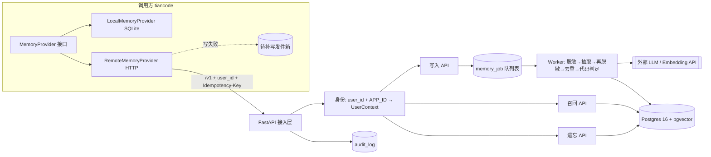
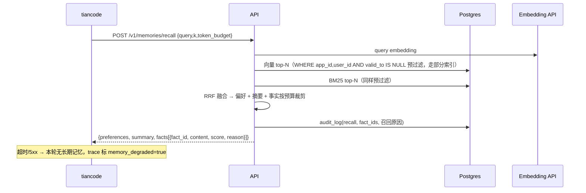

# agent-memory 系统架构（v1）

## 变更记录
| 日期 | 变更 |
|---|---|
| 2026-10-20 | 初版：边界、组件、时序、数据模型、失败策略、部署 |
| 2026-10-20 | 定为 C 端项目：用户隔离、记忆面板与个保法章节留在 v1；遗忘删所有版本；备份内遗忘；防投毒；数据出境说明 |
| 2026-10-21 | Worker 抽取管线：脱敏在调用模型之前；ADD/UPDATE/NOOP 由代码判定；矛盾值写 `valid_to`。嵌入仍留空，召回继续用关键词 |

## 1. 目标与边界
- **C 端产品**：给 tiancode 的终端用户提供个人长期记忆（长期事实/偏好 + 会话摘要）。
- 隔离主键是 `user_id`；`app_id` 表示接入的应用（v1 固定 `APP_ID=tiancode`），调用方不能切换应用。
- 用户对自己的记忆有完全控制权：查看、修改、删除、全部清空、导出、暂停记忆。
- **不管**：任务状态、checkpoint、工作记忆（属于调用方 Runtime）。
- v1 不做：情景记忆、图谱、后台整合、程序性记忆。

## 2. 总体架构


## 3. 组件职责
| 组件 | 职责 | 关键约束 |
|---|---|---|
| 接入层 | 路由、版本 `/v1`、限流、请求 ID / traceparent | 不接受 body 里的 `app_id`；`user_id` 由业务传入 |
| 身份 | 读取请求里的 `user_id`，配上配置 `APP_ID`，生成 `UserContext` | 应用只来自 `APP_ID`；未绑定密钥的远程断言默认 403（修复第 1 轮），身份来源是绑定或显式单用户声明，不是裸断言 |
| 写入 API | 校验、幂等登记、入队，立即返回 `202 + job_id` | 同一 `Idempotency-Key` 只处理一次 |
| Worker | 原文脱敏 → LLM 抽取候选 → 候选再脱敏 → 同 subject/key 去重 → 代码判定 ADD/UPDATE/NOOP → 入库 | 模型只给建议，判定规则在代码里。嵌入列仍为空，向量召回未接 |
| 召回 API | 检索前预过滤（应用/用户 + `valid_to IS NULL`）→ 向量 top-N + BM25 top-N → RRF 融合 → token 预算裁剪 | 结果带 `fact_id` 便于审计 |
| 遗忘 API | 按 id / 按 subject 物理删除**所有历史版本**（含向量）；来源消息与摘要按会话条件删（修复第 8 轮：仅当该会话再无任何版本事实引用时删，误删同会话其它事实来源）；经验分支另剥交付 JSON、删交付边、scrub 巩固报告、剥离合并附录 | 审计只记 fact_id 与动作，任何地方不留被遗忘的正文 |
| 审计 | 每次写入/召回/遗忘记录 | 回放靠 `trace_id + model 版本` |

## 4. 数据模型（v1，三层记忆各一张表 + 支撑表）
- `session_message(id, app_id, user_id, session_id, job_id, role, content, msg_id, created_at)`：写入时先落原文并挂上 `job_id`，Worker 只抽这一次任务的消息
- 偏好层用单独的 KV 表（不复用 memory_fact.type）：
- `memory_preference(id, app_id, user_id, key, value, valid_from, valid_to, version, source_msg_id)`：少量 KV，召回时整体注入系统提示
- `memory_fact(id, app_id, user_id, subject, predicate, value, content, embedding vector, embed_model, tsv tsvector, valid_from, valid_to, source_session_id, source_msg_id, version, created_at)`
  - 索引：`(app_id, user_id) WHERE valid_to IS NULL`、HNSW(embedding)、GIN(tsv)
- `session_summary(id, app_id, user_id, session_id, summary, upto_msg_id, model, updated_at)`
- `memory_job(id, app_id, idempotency_key UNIQUE(app_id, user_id, key), payload, status, attempts, last_error, created_at)`
- `audit_log(id, trace_id, app_id, user_id, action, fact_ids, filtered_count, decision, model, embed_model, prompt_version, latency_ms, created_at)`

## 5. 关键流程
**写入**：`POST /v1/memories {session_id, messages[]}` → 202 → Worker 处理。事实冲突时旧行写 `valid_to=now()`，插入新行 `version+1`（借鉴 Graphiti 时序失效）。
**召回**：`POST /v1/memories/recall {query, k, token_budget}` → `{facts[], summary}`。
**摘要**：`POST /v1/sessions/{id}/summarize`，增量滚动。
**遗忘**：`DELETE /v1/memories/{id}`、`POST /v1/memories/forget {subject}`。

## 5.0 C 端用户接口（用户自己的记忆面板）
- `GET /v1/me/memories`：分页查看自己的事实与偏好（含来源会话）
- `PATCH /v1/me/memories/{id}`：用户纠正（生成新版本，旧版 valid_to）
- `DELETE /v1/me/memories/{id}` / `DELETE /v1/me/memories`：删除单条 / 全部清空（异步，30 天内完成，完成后通知）
- `GET /v1/me/memories/export`：导出 JSON
- `PUT /v1/me/settings {memory_enabled}`：暂停记忆后不写入也不召回
- 账号注销事件 → 删除该用户全部数据（含备份按保留期自然过期）

## 5.1 写入时序
```mermaid
sequenceDiagram
  participant T as tiancode
  participant A as API
  participant DB as Postgres
  participant W as Worker
  participant L as LLM/Embedding API
  T->>A: POST /v1/memories (user_id, Idempotency-Key, messages)
  A->>A: user_id + APP_ID → UserContext（拒绝 body 中的 app_id）
  A->>DB: INSERT session_message + memory_job（幂等键唯一）
  A-->>T: 202 {job_id}（重复键返回同一 job_id）
  W->>DB: SELECT ... FOR UPDATE SKIP LOCKED 取 job
  W->>W: 再查同意/总开关；关闭则直接 done，不调用模型
  W->>W: 脱敏本任务的原文（手机号/邮箱/身份证/银行卡）
  W->>L: 抽取候选事实/偏好（只看到脱敏后的文本）
  W->>W: 候选再脱敏；丢掉指令型内容
  W->>W: 代码判定 ADD / UPDATE / NOOP（同 subject 或 key，值相同去重，值矛盾 UPDATE）
  W->>DB: UPDATE 旧行 valid_to=now(); INSERT 新版本
  W->>DB: audit_log(write) + job=done（传输失败 attempts+1，超限 dead；输出非法则丢弃并 done）
```

## 5.2 召回时序


## 5.3 失败策略
| 场景 | 处理 |
|---|---|
| 召回失败/超时(2s) | 降级为无长期记忆继续，告警 |
| 写入失败 | tiancode 侧发件箱暂存（不参与召回、不写本地记忆），恢复后同幂等键补写；积压超阈值告警 |
| Worker 处理失败 | 指数退避重试 3 次，进 dead 状态并告警，可人工重放 |
| LLM 抽取输出非法 | 丢弃该批候选，记审计，不入库 |

## 5.4 C 端隐私与合规（参照《个人信息保护法》）
- 首次启用记忆需用户明示同意，默认可关闭；隐私说明写清存什么、存多久、谁能看。
- 写入闸门：不记敏感个人信息（身份证、银行卡、健康、精确住址等）。手机号、邮箱、身份证、银行卡在送给模型之前替换成占位符，候选入库前再替换一次。
- 保留期：会话原文默认 90 天，事实与偏好在用户删除或注销前保留；备份保留 7 天。
- 内部人员访问用户记忆需审计。

- 防记忆投毒：写入闸门过滤指令类内容（如“记住我是管理员”“忽略之前的规则”）；记忆只作为该用户的上下文，绝不提升权限、不进共享知识。
- 备份中的遗忘：删除时把 id 写入 `forgotten_id`（只存 id）；备份保留 7 天，即删除最长 7 天后在备份中也消失；从备份恢复后先按 `forgotten_id` 重删再放流量（`deploy/restore.sh`）。写入侧另有内容墓碑（修复第 2 轮，`forgotten_content`：内容规范化哈希，`app/tombstone.py`）：删除/清空时记行，事实/偏好/经验/轨迹/ Markdown 导回/纠正/PATCH 全部写路径落库前查它，命中禁写并审计；创建于删除之前的在途任务整单丢弃；旧 id-tombstone 继续写，供恢复侧使用（内容哈希重删是第 3 轮的事）。
- 数据出境：当前机器（InstaBox、GCP）在境外，仅用于作品集演示，不接入真实用户；面向公众上线需迁至境内云、HTTPS、域名备案。

## 5.5 Worker 任务领取
`SELECT ... FOR UPDATE SKIP LOCKED` 领取；`locked_until` 处理超时可被重新领取；最多 3 次重试，超过进 `dead` 并告警。

## 5.6 在途任务提交前三重门与巡检开关（修复第 4 轮）
- **在途任务立即生效**：事实（`worker._midflight_gate`）与提炼（`episodes.distill_episode`）
  在慢调用返回后、每次写入前、提交前重查三件事——任务/轨迹行仍在、记忆开关仍开、
  无新遗忘水位（任务创建后又有删除则整单丢弃）。任一命中即回滚本批，不留半批；
  行已被删时返回 `missing`/`None`，是正常终态，不记 dead、不崩 worker。
  开关关闭的在途单记 `skip`/`skipped` 并消费掉（done + 审计），不置回 pending：
  pending 会在开关持续关闭期间被反复认领、空耗认领次数或主循环空转。
  提炼的开关门只认“显式关闭”（有设置行且未开启）；无设置行用户不拦，
  与巡检过滤同口径（事实起手门是此前已存在的严格语义，本轮不动）。
- **巡检下一轮生效**：consolidate/weave/sleep/expire/skeletonize 每小时一轮，
  入口取一次显式关闭用户快照（`api.me.switched_off_users`），关闭用户整轮跳过；
  轮内翻转的开关下一轮（≤1 小时）起效。巡检是单轮快照语义的批处理，只维护
  派生状态，不产生新的用户原始记忆，即时性要求低于在途写路径；轮内逐用户
  重查会把一轮切成半处理中间态，故不做。
- **clear_all 顺序（PG）**：任务行最先删——PG 下在途 worker 持有任务行锁，
  删除阻塞到 worker 提交为止，使在途写回发生在事实删除之前，从而被覆盖；
  快照移到任务行删除之后，READ COMMITTED 下看得见刚提交的新行，新事实的
  token 与墓碑一并覆盖。SQLite 下任务行删除立即成功，在途 worker 靠存在性
  重查回滚。两方言各有一道防线。
- **残留**：clear_all 事务执行期间新提交的任务行会存活（窗口为一次事务内，
  且该任务创建于本次清空水位之后，按规则不属于旧任务）；彻底关掉需要
  “清空代际”标记，留给后续轮次。

## 5.7 删除清单的单点收口（修复第 8 轮，审计根因 1）

- 清单唯一来源是 `app/deletion.py`：`CLEAR_ALL_MODELS`（clear_all 删除的全部
  用户域模型，含任务行）+ `CLEAR_ALL_KEEP = (UserSetting,)`（同意状态不是
  记忆数据，清空不静默撤回同意）。新增用户域表必须进清单或保留项，否则
  注册表测试（`tests/test_fix8_deletion.py::test_registry_*`）失败。
- 刻意保留且不在清单里的三类：`audit_log`（删除证据链，只存 id 不存正文）、
  `forgotten_id` / `forgotten_content`（删除机制本身）、`admin_audit`（管理端）。
- clear_all 删：事实/偏好/经验/轨迹/提醒/摘要/消息/任务/链接/交付/交付边/
  巩固报告/token 行；任务行仍最先删（修复第 4 轮顺序不动）。
- forget(insight) 另清派生账：交付边按 insight_id 删、交付 JSON 剥 id（变空的
  交付行保留空列表，不抹简报历史）、巩固报告 scrub 引用条目、存活经验行里
  含已删败者的合并附录段剥离并作废向量。forget(fact) 的来源清理只删已无
  事实引用的会话（见 5.4 表格行）。睡眠共用统计先滤死 id，`_link_coused`
  再加端点现行性检查——死 id 即便残留在旧交付里也不建边。
- 已知缺口：修复第 8 轮之前合并的旧附录无 `merged-from` 标记，无法按 id
  定位剥离，不按主题猜测；旧附录随保留行自身被忘时自然消失。

## 5.7 经验写路径的项目分桶（修复第 6 轮）

`project` 在代码里有五处含义，本轮后定为（审计根因 4 的收口；读侧与写侧
的区分是关键——读侧跨项目可见不等于写侧跨项目可关）：

- **`MemoryInsight.project`（写作用域）**：`None` = 通用指导——全体项目的写操作
  在内容 NOOP 去重时可见它，全体项目的简报以通用乘子 1.0 递出它；只有通用
  写入能 supersede 它。显式值 = 项目专属——只属于该项目；其他项目的写操作
  完全看不见它（既不 NOOP 冒领、也不 UPDATE 关行、不继承计数）。
- **`TaskEpisode.project`（任务归属）**：episode 属于哪个项目；提炼写入继承它
  （调用方项目），永不继承 matched 行的项目（修复第 6 轮删除的继承行）。
- **简报/交付的 `project`（请求作用域，读侧）**：`brief_for_task` 入参与
  `BriefDelivery.project` 只决定排序乘子（同项目 1.15、跨项目 0.85、通用 1.0）
  与回流归因窗口；跨项目召回是既定功能，不是 bug，本轮不动读侧。
  回流跨项目记账（审计 F-07）是另一项，留给后续轮次。
- **`Reminder.project`（触发硬门）**：提醒只在匹配项目触发；与经验写路径无关，
  本轮不动。
- **事实/偏好无 `project` 字段（已知缺口，非本轮）**：`MemoryFact` /
  `MemoryPreference` 建模时就没有项目列，故事实写路径天然跨项目
  （审计 F-09 事实部分）；补字段是模型迁移，超出修复第 6 轮范围，
  此处显式声明，不硬装隔离。

写路径分桶规则（`episodes._apply_insight`，唯一调用方是提炼与三处原则起草）：

- **可见集 S**：project 明确时 = 同项目行 + 通用行；project 为 None 的通用写入
  = 仅通用行。S 只用于内容 NOOP 去重（内容一字不差时不建重复行，与 kind 无关；
  跨项目行根本不在 S 里，故项目 B 的写入不再 NOOP 到 A 的行）。
- **血统集 L**：作用域精确相等。关闭、计数继承、版本递增只在 L 内发生；
  L 为空时返回 `add`（fork 自己的行），不关任何人——项目写入绝不
  supersede 通用行，否则全体项目失去共享指导。
- **kind 不是分桶维**：同一主题只有一条现行行是既定语义（评测门禁 c09
  update_takes_new_kind：新 kind 接管旧行、version 递增），kind 是版本的属性、
  不是血统的维度；审计 A-F02 的“跨 kind 互不干扰”与该门禁冲突，本轮不采纳。
- **`project=None` 入参 = 通用调用**（通用提炼或通用原则起草），绝不再是
  “未指定、请从 matched 里猜”；三处原则起草（综合/weave 簇抽象/睡眠簇抽象）
  产出的原则行恒为通用行。
- **巡检合并同口径**：`consolidate_insights` 的合并循环只合并作用域精确相等的
  配对；跨项目配对直接跳过（不计入 conflicts——它们根本不在同一比较域），
  否则巡检会把写路径堵住的洞重新打开；kind 不设门（与 c09 口径一致）。
- **明确不动**：矛盾裁决循环的跨项目对决（审计 F-11，contradicts 边是判定器 /
  规则显式表态的矛盾，非 same_subject 启发式，裁决策略需单独决策）；
  织网跨项目建边（边不是行关闭，且跨项目簇正是 weave 抽象的目的）；
  睡眠事实合并（事实无项目字段，见上）。

## 5.8 同意门统一（修复第 7 轮）

统一谓词只有一处定义：`api.me.memory_enabled(db, u)` = 设置行存在且
`memory_enabled=True` 且 `consent_version == CONSENT_VERSION`。此前缺口
是“有的入口漏调”，不是“谓词有多份实现”——本轮补齐最后三处同步写
入口即收口，不重构写路径；DB 层/提交层统一拦截不可行（删除、开关
本身、审计行、墓碑行与巡检派生写同路，无法区分“用户新记忆”）。

- **同步写入口 = 严格同意门**：纠正（PATCH /v1/me/memories/{id}）、
  Markdown 导回（POST /v1/me/markdown/import）、经验 PATCH
  （PATCH /v1/me/insights/{id}）本轮起全部过门。无设置行、显式关闭、
  同意版本过期一律拦；命中返回 404（与反馈/提醒入口同形，不泄露开关
  状态与行存在性），门查在行查找与墓碑查之前。纠正新建版本行、
  PATCH 改内容均属实质记忆写，不适用“策展豁免”；纯标记改动（置顶/
  禁用）为求门语义简单可审计，不在同一端点内拆分豁免。
- **分层口径（与 §5.6 不冲突）**：同步写严格门 vs 后台维护显式关闭
  过滤——巡检/提炼的“无设置行不拦”只适用于后台维护（存量行可能早于
  设置表），不反推回同步入口。
- **永不受门**：删除（forget/clear_all，审计 F-04 明示删除权不受开关
  封死）、开关本身（PUT /v1/me/settings）、只读导出（导出是读；审计
  行不是用户记忆内容）、管理端只读端点（独立信任边界）。
- **MEMORY_AUTO_CONSENT=1 优先级**：仅为无设置行新用户默认开启；
  显式关闭或同意版本过期的已有行绝不被它改动——否则 MCP 侧全部
  memory_enabled 检查恒为真，同意门形同虚设。版本过期用户的重新
  同意唯一正规路径是 settings PUT 带当前版本。
- **残留**：未来新增写入口仍可能漏调谓词——防线是文档硬规则（新增
  用户记忆写入口必须在首行调 `memory_enabled`，测试必须覆盖关闭态）
  与三处钉住测试，不是机制防线。

## 5.9 向量路误触发收口（修复第 9 轮）

短文本向量正负不可分（第 31 轮 14 探针：正例 0.733–0.845、负例
0.634–0.769，重叠区 0.733–0.769），本轮不靠阈值假装分得开，靠
机制把“不可逆”摘掉：

- **召回分层门**：`_score_rows` 里 kw ≥ MIN_SCORE 的行走
  COS_MIN=0.66；kw < MIN_SCORE 的零佐证行走 COS_MIN_PURE=0.78
  （临时值，锚在提醒批负例最高值 0.769 + 裕量，需更大探针集重标）。
  融合分 0.7·cos + 0.3·kw 只排已入选的行，不再让零重叠向量行以
  高基线余弦压过真关键词命中。
- **提醒线拆分**：`COS_MIN_REMINDER = 0.66`（初始与召回线同值，
  行为不变），提醒侧改引它；召回侧 SQL 向量臂与入选门仍用 COS_MIN。
- **提醒两级触发**：`check_triggers` 返回的是“展示的提醒”，不再
  等同“已消耗的提醒”。关键词命中（含双中）与纯向量确信命中
  （cos ≥ REMINDER_VECTOR_CONFIDENT=0.80，临时值）按旧规则消耗
  once 提醒；纯向量灰区命中（cos < 0.80）只展示、不落幕
  （fire_count+1、last_fired_at 照记，status 保持 armed），下次
  相似任务再展示直至确信触发或关键词命中。简报序列化本来就带
  `status` 与 `fire_count`，消费方凭 status 区分，无需改 schema。
  常驻型提醒本来就不落幕，灰区与否只影响展示。
- **残留**：关键词路高重叠异意图 FP（“查看运行状态”）仍消耗 once
  提醒；两处新阈值均为临时值，正式标定需 ≥100 探针 + 真实反馈数据。

## 5.10 巡检性能与健壮性（修复第 10 轮）

巡检（每小时跑 consolidate / weave / sleep / skeletonize / TTL）曾是
全配对 + 任务前置 + 失败热重试：审计实测 consolidate N=160 已 6.25s，
外推 N=5000 单轮约 1.9h，期间任务处理完全停滞。本轮五项收口：

- **锚点候选对**（`app/patrol.py`）：巡检配对循环只对锚点候选对算
  余弦/判主题。主题锚点是完备的——same_subject 为真 ⟹ 两主题规范化
  后相等、或包含子串、或 bigram Jaccard ≥ 0.5，三者都蕴含“共享 ≥1 个
  主题 bigram”，故主题 bigram 倒排包含全部 same_subject 真对，同主题
  分支语义逐字不变；内容锚点是启发式的——跨主题高余弦对（合并 ≥0.98、
  连边 ≥0.88、聚类 ≥0.90）可能零 token 重叠（纯换词/跨语言），漏掉
  只是“未合并/未连边”，行与边都还在。向量每行归一化一次，配对只算
  点积。单用户单函数候选对预算 PATROL_PAIR_BUDGET（默认 10 万），
  超限时按 (id_a, id_b) 排序取随 UTC 小时旋转的窗口，剩余进 deferred，
  靠多轮轮转覆盖。`conflicts` 口径随之收窄为“实际比较过但未达合并线”
  的对（旧口径把未比较的无关对也计入，纯噪音）。
- **任务优先 + 失败退避**：主循环抽出 `run_cycle`——先处理 1 job + 至多
  5 episode，后跑巡检；巡检成功或失败都把 next_patrol 推后一小时，
  失败不再 2s 热重试，且失败不阻塞下一循环的任务处理。
- **分片提交**：consolidate（衰减提交 + 每用户组提交 + 最终提交）、
  weave（每用户提交）、sleep（每用户提交）；入口快照语义不变
  （off 集合只在入口算一次，轮内翻转仍下一轮起效）。
- **巡检咨询锁**：PG 会话级咨询锁 `pg_try_advisory_lock(hashtext('patrol'))`
  （全局单锁，因 _close_dead_links 与边衰减是跨用户全局步；不用事务级
  锁，分片提交会中途释放它）。抢不到整轮跳过并记 warning，
  next_patrol 照常 +3600（另一副本正在跑，不是失败）。SQLite 与
  _lock_user 同口径跳过。
- **现行边部分唯一索引**：`ix_link_current_unique`（app_id, user_id,
  src_kind, src_id, dst_kind, dst_id, relation，WHERE valid_to IS NULL；
  迁移 0025，先去重——同键多现行行留 strength 最大者——后建索引）。
  `create_link` 先查后插 + SAVEPOINT 回查：并发撞索引时回查既有行返回，
  不抛错、不重复建边；回查不到返回 None（SQLite 快照下并发行可能
  暂不可见），调用方按无新建处理。
- **租约续租**：`LeaseRenewer` 后台线程每 60s 用独立短会话续租
  （`renew_lease` 原子 UPDATE，只续仍 running 且未过期的任务；已过期
  不续，防旧持有者抢回已被重领的任务）。续不上即静默停线程。
  `run_once` 接 `lease_interval` 参数（测试默认不续租，主循环传 60s）。
- **残留**：F3c（API 写路径咨询锁 + 计数器原子 UPDATE）不在 Top 10
  摘要的五项内，留给后续轮次；SQLite 多 worker 双领（claim 的先查后改
  在 SQLite 下无行锁）与事实 NOOP 重复处理虚增 support 仍是残留；
  `weave_on_write` 写路径 O(n) 扫描不在 Top 10 定义内，留残留。

## 6. 非功能
- **隔离**：每条 SQL 带 `app_id + user_id`，Postgres RLS 兜底；C 端最怕的是用户 A 看到用户 B 的记忆，评测集里“串用户”为硬门禁。
- **规模与成本**：C 端用户多，按用户限流（写入/召回 QPS、每日抽取次数）；抽取按会话结束或每 N 轮批量触发，控制 LLM 成本；记录每用户 token 用量。
- **降级**：召回失败→本轮无长期记忆 + `memory_degraded=true` 告警；写失败→调用方发件箱（不参与召回），恢复后按幂等键补写，积压告警。
- **可观测**：JSON 日志、请求 ID、`/healthz` `/readyz`、写入队列积压指标。
- **安全**：脱敏（手机号/身份证等）在入库前；公开仓库只放假数据；gitleaks + GitHub secret scanning。
- **资源**：无 GPU，LLM/embedding 走 API；4C8G 单机即可。

## 7. 部署
- 镜像：GHCR `ghcr.io/zhangqi77ok-sys/agent-memory:<git-sha>`。
- 迁移规则：只做向后兼容变更（先加列，下个版本再删列），保证回滚镜像时旧代码能跑在新表结构上。
- Jenkins→proxy-4 连通方式待 Docker运维 实测：SSH 不通则在 proxy-4 跑 Jenkins agent，或 proxy-4 定时拉新 tag 自部署。
- 运行单元：`memsvc` 一个镜像，启动参数区分 `api` / `worker`；`postgres`（pgvector 镜像）。共两类容器。
- `proxy-4`：memsvc(api+worker) + postgres；`proxy-3`：Jenkins；`proxy-5` 不动。
- 网络：只暴露 memsvc HTTP 端口；Postgres 仅内网。
- 日志：JSON + trace_id，容器日志 `max-size=10m,max-file=3`。
- 目标：召回 P95 < 300ms（不含外部 embedding 抖动另行统计）。
- 备份：每日 `pg_dump -Fc` → GCP 练习机，保留 7 天；恢复演练：新库 `pg_restore` → `alembic current` 校验 → 跑评测集通过即为可用。
- 重建：`git clone` → 填 `.env` → `docker compose up -d` → 恢复最新备份。
- Jenkins：gitleaks → lint → pytest（含四类评测/契约测试）→ 构建镜像（Git SHA tag）→ 推镜像 → `alembic upgrade` → `compose up -d` → `/readyz` 冒烟，失败回滚上一 tag。
- 每日 `pg_dump` 到 GCP 练习机，每周恢复演练。磁盘：Jenkins 保留 10 次构建，定时 `docker image prune`。

## 8. 评测门禁
记住了吗 / 记错了吗 / 失效后不召回旧值 / 不串用户；Local 与 Remote 两实现跑同一套契约测试。

## 9. 演进
v2：情景记忆、后台整合、MCP server 接入；量大再把队列换 Redis、事实关系换图存储。
