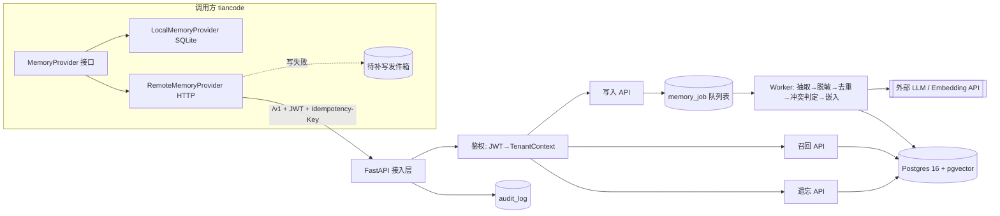
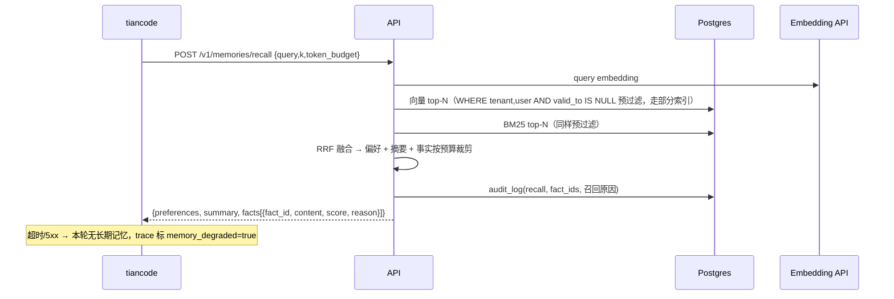

# agent-memory 系统架构（v1）

## 变更记录
| 日期 | 变更 |
|---|---|
| 2026-10-20 | 初版：边界、组件、时序、数据模型、失败策略、部署 |
| 2026-10-20 | 定为 C 端项目：用户隔离、记忆面板与个保法章节留在 v1；遗忘删所有版本；备份内遗忘；防投毒；数据出境说明 |

## 1. 目标与边界
- **C 端产品**：给 tiancode 的终端用户提供个人长期记忆（长期事实/偏好 + 会话摘要）。
- 隔离主键是 `user_id`；`tenant_id` 表示接入的应用（v1 只有 `tiancode`），用于以后多个 App 共用同一服务。
- 用户对自己的记忆有完全控制权：查看、修改、删除、全部清空、导出、暂停记忆。
- **不管**：任务状态、checkpoint、工作记忆（属于调用方 Runtime）。
- v1 不做：情景记忆、图谱、后台整合、程序性记忆。

## 2. 总体架构


## 3. 组件职责
| 组件 | 职责 | 关键约束 |
|---|---|---|
| 接入层 | 路由、版本 `/v1`、限流、请求 ID / traceparent | 不接受 body 里的 tenant_id/user_id |
| 鉴权 | 校验 JWT（服务间 token + 透传用户 token），生成 `TenantContext` | 租户只来自 token |
| 写入 API | 校验、幂等登记、入队，立即返回 `202 + job_id` | 同一 `Idempotency-Key` 只处理一次 |
| Worker | LLM 抽取候选事实 → 脱敏 → 相似检索去重 → 规则判定 ADD/UPDATE/NOOP → 嵌入 → 入库 | 模型只给建议，判定规则在代码里 |
| 召回 API | 检索前预过滤（租户/用户 + `valid_to IS NULL`）→ 向量 top-N + BM25 top-N → RRF 融合 → token 预算裁剪 | 结果带 `fact_id` 便于审计 |
| 遗忘 API | 按 id / 按 subject 物理删除**所有历史版本**（含向量）；受影响的 `session_summary` 重新生成或删除；`session_message` 中来源原文一并删除 | 审计只记 fact_id 与动作，任何地方不留被遗忘的正文 |
| 审计 | 每次写入/召回/遗忘记录 | 回放靠 `trace_id + model 版本` |

## 4. 数据模型（v1，三层记忆各一张表 + 支撑表）
- `session_message(id, tenant_id, user_id, session_id, role, content, msg_id, created_at)`：写入时先落原文，Worker 从这里取
- 偏好层用单独的 KV 表（不复用 memory_fact.type）：
- `memory_preference(id, tenant_id, user_id, key, value, valid_from, valid_to, version, source_msg_id)`：少量 KV，召回时整体注入系统提示
- `memory_fact(id, tenant_id, user_id, subject, predicate, value, content, embedding vector, embed_model, tsv tsvector, valid_from, valid_to, source_session_id, source_msg_id, version, created_at)`
  - 索引：`(tenant_id, user_id) WHERE valid_to IS NULL`、HNSW(embedding)、GIN(tsv)
- `session_summary(id, tenant_id, user_id, session_id, summary, upto_msg_id, model, updated_at)`
- `memory_job(id, tenant_id, idempotency_key UNIQUE(tenant_id, key), payload, status, attempts, last_error, created_at)`
- `audit_log(id, trace_id, tenant_id, user_id, action, fact_ids, filtered_count, decision, model, embed_model, prompt_version, latency_ms, created_at)`

## 5. 关键流程
**写入**：`POST /v1/memories {session_id, messages[]}` → 202 → Worker 处理。事实冲突时旧行写 `valid_to=now()`，插入新行 `version+1`（借鉴 Graphiti 时序失效）。
**召回**：`POST /v1/memories/recall {query, k, token_budget}` → `{facts[], summary}`。
**摘要**：`POST /v1/sessions/{id}/summarize`，增量滚动。
**遗忘**：`DELETE /v1/memories/{id}`、`POST /v1/memories/forget {subject}`。

## 5.0 C 端用户接口（用户自己的记忆面板）
- `GET /v1/me/memories`：分页查看自己的事实与偏好（含来源会话）
- `PATCH /v1/me/memories/{id}`：用户纠正（生成新版本，旧版 valid_to）
- `DELETE /v1/me/memories/{id}` / `DELETE /v1/me/memories`：删除单条 / 全部清空（异步，30 天内完成，完成后通知）
- `GET /v1/me/memories/export`：导出 JSON
- `PUT /v1/me/settings {memory_enabled}`：暂停记忆后不写入也不召回
- 账号注销事件 → 删除该用户全部数据（含备份按保留期自然过期）

## 5.1 写入时序
```mermaid
sequenceDiagram
  participant T as tiancode
  participant A as API
  participant DB as Postgres
  participant W as Worker
  participant L as LLM/Embedding API
  T->>A: POST /v1/memories (JWT, Idempotency-Key, messages)
  A->>A: JWT→TenantContext（拒绝 body 中 tenant/user）
  A->>DB: INSERT session_message + memory_job（幂等键唯一）
  A-->>T: 202 {job_id}（重复键返回同一 job_id）
  W->>DB: SELECT ... FOR UPDATE SKIP LOCKED 取 job
  W->>L: 抽取候选事实/偏好
  W->>W: 脱敏
  W->>L: embedding
  W->>DB: 同租户相似检索去重
  W->>W: 规则判定 ADD / UPDATE / NOOP
  W->>DB: UPDATE 旧行 valid_to=now(); INSERT 新版本
  W->>DB: audit_log(write) + job=done（失败 attempts+1，超限 dead）
```

## 5.2 召回时序


## 5.3 失败策略
| 场景 | 处理 |
|---|---|
| 召回失败/超时(2s) | 降级为无长期记忆继续，告警 |
| 写入失败 | tiancode 侧发件箱暂存（不参与召回、不写本地记忆），恢复后同幂等键补写；积压超阈值告警 |
| Worker 处理失败 | 指数退避重试 3 次，进 dead 状态并告警，可人工重放 |
| LLM 抽取输出非法 | 丢弃该批候选，记审计，不入库 |

## 5.4 C 端隐私与合规（参照《个人信息保护法》）
- 首次启用记忆需用户明示同意，默认可关闭；隐私说明写清存什么、存多久、谁能看。
- 写入闸门：不记敏感个人信息（身份证、银行卡、健康、精确住址等），抽取后再做规则脱敏。
- 保留期：会话原文默认 90 天，事实与偏好在用户删除或注销前保留；备份保留 7 天。
- 内部人员访问用户记忆需审计。

- 防记忆投毒：写入闸门过滤指令类内容（如“记住我是管理员”“忽略之前的规则”）；记忆只作为该用户的上下文，绝不提升权限、不进共享知识。
- 备份中的遗忘：删除时把 id 写入 `forgotten_id`（只存 id）；备份保留 7 天，即删除最长 7 天后在备份中也消失；从备份恢复后先按 `forgotten_id` 重删再放流量（`deploy/restore.sh`）。
- 数据出境：当前机器（InstaBox、GCP）在境外，仅用于作品集演示，不接入真实用户；面向公众上线需迁至境内云、HTTPS、域名备案。

## 5.5 Worker 任务领取
`SELECT ... FOR UPDATE SKIP LOCKED` 领取；`locked_until` 处理超时可被重新领取；最多 3 次重试，超过进 `dead` 并告警。

## 6. 非功能
- **隔离**：每条 SQL 带 `tenant_id + user_id`，Postgres RLS 兜底；C 端最怕的是用户 A 看到用户 B 的记忆，评测集里“串用户”为硬门禁。
- **规模与成本**：C 端用户多，按用户限流（写入/召回 QPS、每日抽取次数）；抽取按会话结束或每 N 轮批量触发，控制 LLM 成本；记录每用户 token 用量。
- **降级**：召回失败→本轮无长期记忆 + `memory_degraded=true` 告警；写失败→调用方发件箱（不参与召回），恢复后按幂等键补写，积压告警。
- **可观测**：JSON 日志、请求 ID、`/healthz` `/readyz`、写入队列积压指标。
- **安全**：脱敏（手机号/身份证等）在入库前；公开仓库只放假数据；gitleaks + GitHub secret scanning。
- **资源**：无 GPU，LLM/embedding 走 API；4C8G 单机即可。

## 7. 部署
- 镜像：GHCR `ghcr.io/zhangqi77ok-sys/agent-memory:<git-sha>`。
- 迁移规则：只做向后兼容变更（先加列，下个版本再删列），保证回滚镜像时旧代码能跑在新表结构上。
- Jenkins→proxy-4 连通方式待 Docker运维 实测：SSH 不通则在 proxy-4 跑 Jenkins agent，或 proxy-4 定时拉新 tag 自部署。
- 运行单元：`memsvc` 一个镜像，启动参数区分 `api` / `worker`；`postgres`（pgvector 镜像）。共两类容器。
- `proxy-4`：memsvc(api+worker) + postgres；`proxy-3`：Jenkins；`proxy-5` 不动。
- 网络：只暴露 memsvc HTTP 端口；Postgres 仅内网；服务间 service token + 透传用户 JWT。
- 日志：JSON + trace_id，容器日志 `max-size=10m,max-file=3`。
- 目标：召回 P95 < 300ms（不含外部 embedding 抖动另行统计）。
- 备份：每日 `pg_dump -Fc` → GCP 练习机，保留 7 天；恢复演练：新库 `pg_restore` → `alembic current` 校验 → 跑评测集通过即为可用。
- 重建：`git clone` → 填 `.env` → `docker compose up -d` → 恢复最新备份。
- Jenkins：gitleaks → lint → pytest（含四类评测/契约测试）→ 构建镜像（Git SHA tag）→ 推镜像 → `alembic upgrade` → `compose up -d` → `/readyz` 冒烟，失败回滚上一 tag。
- 每日 `pg_dump` 到 GCP 练习机，每周恢复演练。磁盘：Jenkins 保留 10 次构建，定时 `docker image prune`。

## 8. 评测门禁
记住了吗 / 记错了吗 / 失效后不召回旧值 / 不串租户；Local 与 Remote 两实现跑同一套契约测试。

## 9. 演进
v2：情景记忆、后台整合、MCP server 接入；量大再把队列换 Redis、事实关系换图存储。
